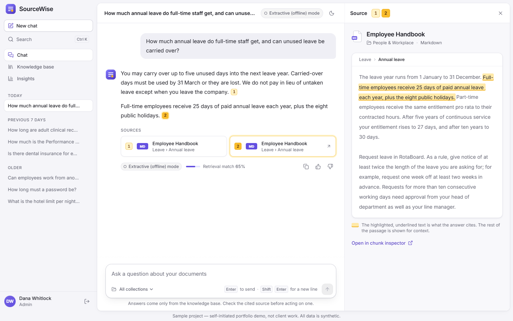
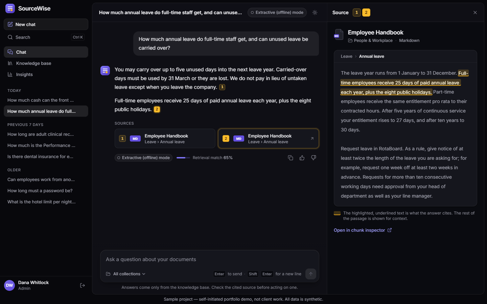
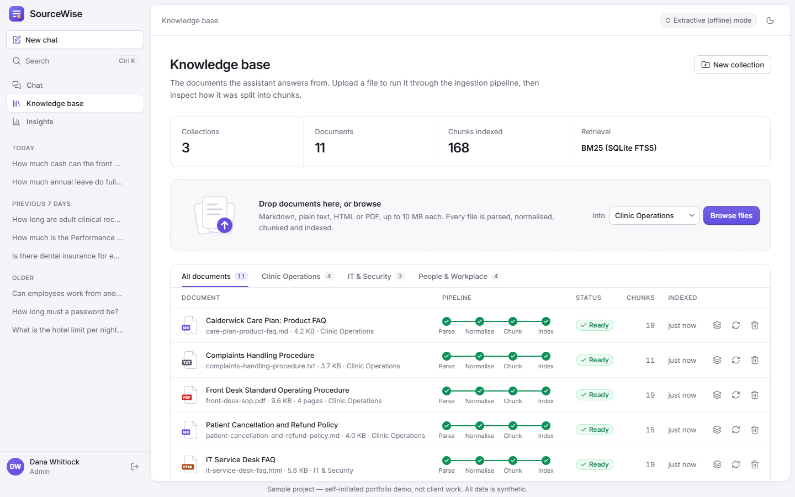
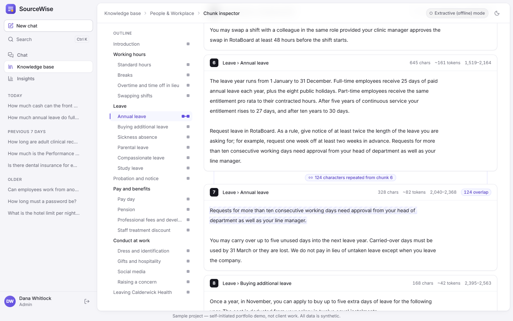
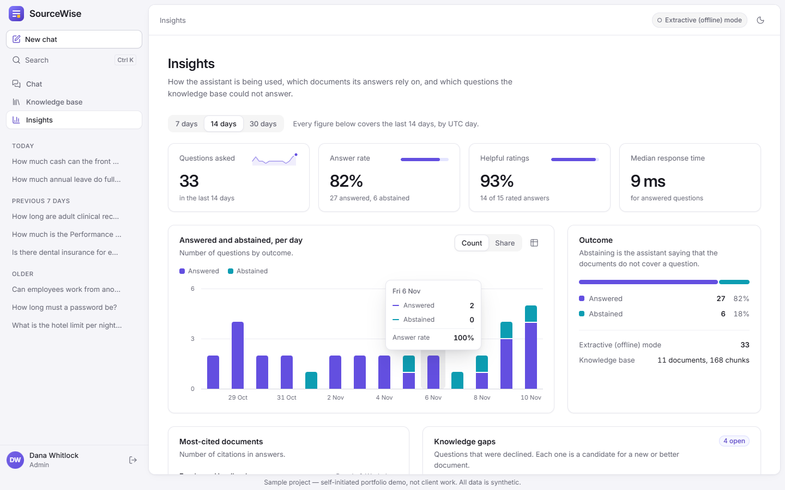
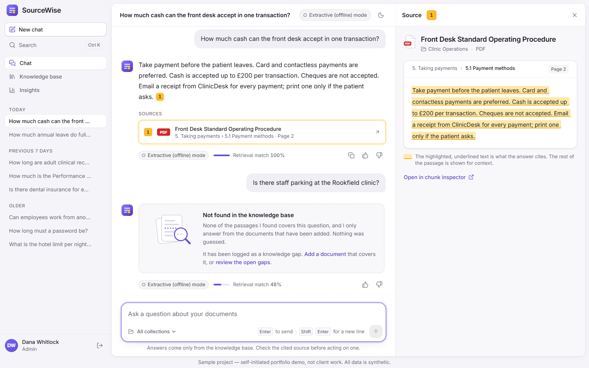
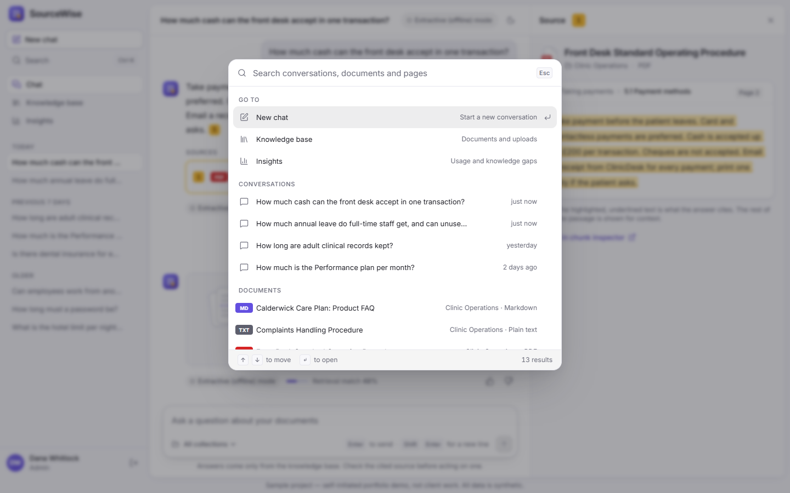
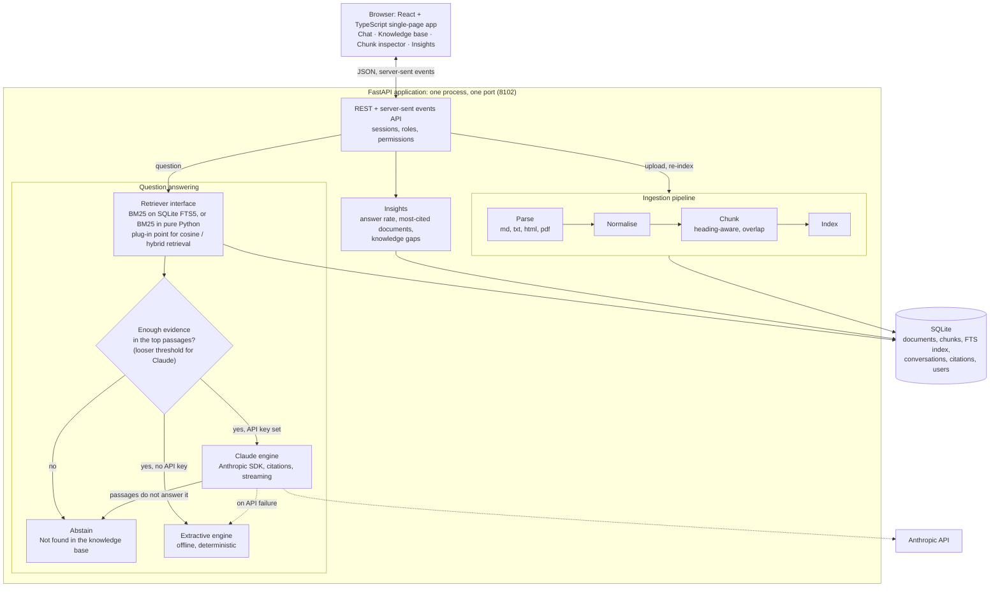
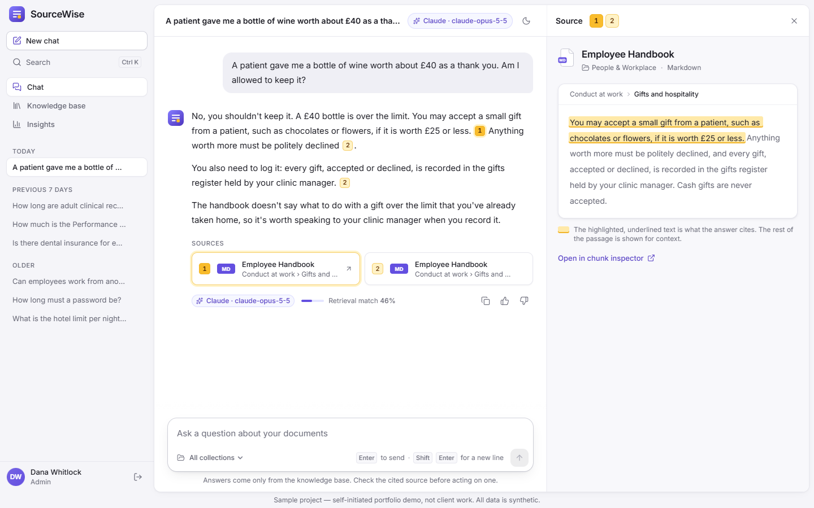

# SourceWise

> **Sample project — self-initiated portfolio demo, not client work. All data is synthetic.**

SourceWise is an AI knowledge assistant: staff ask questions in plain language and get answers
drawn only from their organisation's own documents, with a numbered citation next to every
statement. Clicking a citation opens the source passage with the cited text highlighted, the
document title, the section heading and (for PDFs) the page number. When the documents do not
cover a question, the assistant says "Not found in the knowledge base" instead of guessing.

It ships with a synthetic knowledge base for a fictional group of physiotherapy clinics
("Calderwick Health": 11 documents, 168 chunks) and runs end to end with no API key. With an
Anthropic API key, answers are written by Claude using its native citations feature.



| | |
|---|---|
|  |  |
|  |  |
|  |  |

All eleven screenshots are listed under [Screenshots](#screenshots).

## Contents

- [Features](#features)
- [Screenshots](#screenshots)
- [Architecture](#architecture)
- [Stack](#stack)
- [Design system](#design-system)
- [Quick start](#quick-start)
- [Configuration](#configuration)
- [Answer engines](#answer-engines)
- [Tests](#tests)
- [Evaluation](#evaluation)
- [Adding a vector store or embedding provider](#adding-a-vector-store-or-embedding-provider)
- [Deployment guide (not executed)](#deployment-guide-not-executed)
- [Limitations](#limitations)
- [Verification status](#verification-status)

## Features

**Chat**

- Multi-turn conversations with a conversation list in the sidebar, grouped by day (rename,
  delete), starter questions taken from the collections, and a per-question collection filter.
- Streamed answers with numbered citations. Hovering a citation previews the cited sentence;
  clicking it opens a source panel that reads like a page of the document: the title, the
  trail of section headings, the PDF page, and the cited span highlighted in the passage. On
  wide screens the panel is docked beside the conversation and can be resized; on smaller
  ones it slides over it, as a bottom sheet on a phone.
- Abstention: a retrieval-confidence gate declines questions the documents do not cover, and
  the answer engines decline when the retrieved passages do not support an answer. The reply
  is a calm "Not found in the knowledge base" card, not an error.
- Thumbs up / down on answers, copy answer, and a status chip that always shows which engine
  wrote each answer ("Extractive (offline) mode" or the Claude model). The same chip sits in
  the header of every page.

**Knowledge base (admin)**

- Collections, and upload of `.md`, `.txt`, `.html` and `.pdf` files (drag and drop or browse)
  with a progress bar for each file.
- Ingestion pipeline shown as four connected stages on every document, with per-stage status
  and timing: parse, normalise, heading-aware chunking with sentence-aligned overlap, index.
- Document table with file-type icons, status and chunk counts; re-index and delete.
- Chunk inspector: every chunk with its section path, page, character range and token
  estimate, shown against the outline of the document, with a map of the document and the
  overlapping text marked.

**Insights (admin)**

- Number of questions, answer versus abstain rate, helpful-rating share, response time.
- Answered and abstained questions per day (as counts or as shares, with tooltips and a table
  view), most-cited documents, and knowledge gaps: the questions that were declined, grouped
  and counted, as candidates for new documents.

**Interface**

- Light and dark themes: a switch in the header, remembered, following the operating system
  until a choice is made, and applied before the first paint.
- A command palette (Ctrl+K or Cmd+K) that jumps to conversations, documents and pages.
- Usable from the keyboard throughout, with visible focus, and no motion when the operating
  system asks for reduced motion. See [Design system](#design-system).

**Access control**

- Admin and member roles enforced on the server. Members can chat; only admins can manage the
  knowledge base and see insights. Conversations are private to their owner.
- Passwords hashed with scrypt; opaque session tokens in an HttpOnly, SameSite=Strict cookie,
  stored only as SHA-256 hashes; failed sign-ins are rate limited.

## Screenshots

All at 1440x900, written by `scripts/screenshots.py` from a freshly seeded database in
extractive (offline) mode.

| File | Theme | Shows |
|---|---|---|
| [`01-login.png`](docs/screenshots/01-login.png) | Light | Sign-in page with the brand panel, the product preview and the demo accounts |
| [`02-chat-cited-answer.png`](docs/screenshots/02-chat-cited-answer.png) | Light | A two-part question answered with two citations; the source panel shows the cited sentence highlighted in its passage |
| [`03-chat-pdf-source-and-abstention.png`](docs/screenshots/03-chat-pdf-source-and-abstention.png) | Light | A citation into a PDF with its section trail and page number, then a question that is declined |
| [`04-knowledge-base.png`](docs/screenshots/04-knowledge-base.png) | Light | Collections, upload zone and the document table with each document's ingestion pipeline |
| [`05-chunk-inspector-pipeline.png`](docs/screenshots/05-chunk-inspector-pipeline.png) | Light | Chunk inspector of the PDF: the pipeline stages and the map of the document |
| [`06-chunk-inspector-overlap.png`](docs/screenshots/06-chunk-inspector-overlap.png) | Light | Chunks beside the document outline; two chunks that share text are tied together |
| [`07-insights.png`](docs/screenshots/07-insights.png) | Light | Insights, with the tooltip of one day of the chart |
| [`08-chat-cited-answer-dark.png`](docs/screenshots/08-chat-cited-answer-dark.png) | Dark | The conversation of screenshot 02 |
| [`09-knowledge-base-dark.png`](docs/screenshots/09-knowledge-base-dark.png) | Dark | The knowledge base of screenshot 04 |
| [`10-insights-dark.png`](docs/screenshots/10-insights-dark.png) | Dark | The insights page of screenshot 07 |
| [`11-command-palette.png`](docs/screenshots/11-command-palette.png) | Light | The command palette listing pages, conversations and documents |

To regenerate them:

```powershell
.venv\Scripts\python scripts\screenshots.py
```

The script seeds a temporary database, starts the server on port 8102 in offline mode, drives
the installed Google Chrome through Playwright (no browser download) and writes
`docs/screenshots/*.png`. The dark screenshots are taken last, without asking anything more,
so they show the same data as the light ones. It needs the development requirements and a
free port 8102.

## Architecture



**How a question is answered**

1. The question is analysed (lower-casing, stop-word removal, Porter stemming) and the top 6
   chunks are retrieved with BM25. Headings and titles are indexed as separate, weighted fields.
   A follow-up such as "and for part-timers?" is retrieved together with the previous question.
2. A confidence gate measures how much of the question's informative (IDF-weighted) vocabulary
   the best passages actually contain. Below the threshold the assistant abstains without
   calling any model, and the question is logged as a knowledge gap. The threshold depends on
   the engine. The extractive engine can only quote, so it needs a passage that covers the
   question's wording. Claude reads the passages and declines by itself when they do not
   answer the question, so it is given anything with real lexical evidence; a paraphrased
   question is then no longer turned away before the model has seen the right passage.
3. The passages go to the answer engine. The Claude engine sends each passage as a citable
   document and maps the returned citation objects back to chunk and character range. The
   offline engine quotes the best-matching sentences and marks them `[1]`, `[2]`.
4. The answer is streamed to the browser as server-sent events. Citations are stored as
   snapshots (title, section, page, passage, cited span), so an old answer still shows its
   source after the document is re-indexed or deleted.

**Project layout**

```
sourcewise/            Python package
  api/                 FastAPI routers: auth, collections, documents, chat, insights, meta
  ingestion/           parsers (md, txt, html, pdf), normalisation, chunker, pipeline
  retrieval/           Retriever protocol, BM25 (FTS5 and pure Python), cosine, rank fusion
  answering/           confidence gate, extractive engine, Claude engine, chat service
  text/                stemmer, analyser, sentence splitter
  evaluation.py        offline evaluation
  seed.py              demo accounts, sample corpus, scripted demo activity
frontend/              React + TypeScript + Tailwind source (design tokens in
                       src/styles/tokens.css); dist/ is the committed build
corpus/                11 synthetic documents (Markdown, text, HTML, one 4-page PDF)
eval/                  golden set, development set, results, method notes
tests/                 pytest suite
scripts/               screenshots, smoke test, UI walkthrough, UI audit, sample-PDF generator
docs/                  screenshots, demo video script, case study
```

## Stack

| Layer | Choice |
|---|---|
| Backend | Python 3.12, FastAPI, SQLAlchemy 2 on SQLite (WAL), pydantic-settings, pypdf |
| Retrieval | BM25 on SQLite FTS5, with a pure-Python BM25 that reproduces the same scores when FTS5 is unavailable |
| LLM | Official Anthropic Python SDK (`anthropic`), used only when an API key is configured |
| Frontend | React 19, TypeScript, Vite, Tailwind CSS 4 driven by CSS design tokens, lucide icons, Inter Variable; fonts and all assets are bundled (no CDN) |
| Tests | pytest with FastAPI's TestClient, ruff; Playwright (installed Chrome) for the screenshots, the UI walkthrough and the UI audit |

Stemming, sentence splitting, the Markdown, HTML and text parsers, BM25 and the extractive
engine are implemented in this repository with the standard library, so the offline mode has
no model downloads and no network access.

## Design system

The interface is built from one set of design tokens,
[`frontend/src/styles/tokens.css`](frontend/src/styles/tokens.css). Components use only the
semantic names it defines, never a raw colour.

**Tokens.** CSS custom properties in two layers. *Primitives* are ramps generated in OKLCH:
a cool neutral, an indigo-violet accent ("iris"), a gold, and green, red and orange for
status. *Semantic* tokens are what components use: surfaces (canvas, surface, sunken, card,
raised), three text levels, hairlines, the accent family, the citation family, status
colours, two chart series, and a five-step scale of layered shadows. `@theme` exposes them to
Tailwind as utilities (`bg-surface`, `text-fg-muted`, `border-line`), together with the type
scale (11 to 38 px; 13 px for the interface, 15 px on a 26 px line for reading), radii (4 to
20 px), easings and animations. Spacing is Tailwind's 4 px grid.

**Identity.** One accent, iris. Gold is reserved for citations: the numbered chips, the
source tabs and the highlighted passage, and nothing else.

**Themes.** `data-theme="light"` or `"dark"` on `<html>` selects the semantic values, and
both themes are designed, not derived. The switch in the header stores the choice; until
there is one, the operating-system preference applies. `public/theme-init.js`, a small
same-origin script (the Content-Security-Policy forbids inline scripts), sets the attribute
before the first paint, so there is no flash of the other theme.

**Typography.** Inter Variable with its optical-size axis, bundled; a fallback face with
matching metrics so that text does not move when the font arrives. Reading text has its own
size and measure: answers at 15 px on a 26 px line, source passages and chunks at 14 px on a
28 px line, each with a capped line length. Tables, axes and counters use tabular figures;
large figures use proportional ones.

**Components.** In `frontend/src/components`: buttons (primary, secondary, ghost, danger),
icon buttons with tooltips, badges, key caps, cards, form fields, a segmented control, tabs
with a sliding indicator, menus, modal dialogs, drawers and a bottom sheet, toasts, skeletons,
file-type icons, and empty states with small inline SVG illustrations.

**Charts.** One colour per series, checked for colour-vision deficiency and for contrast on
the chart surface in each theme (iris for answered, teal for abstained). Columns are at most
24 px wide with a 2 px gap between stacked segments; every chart has a legend, a tooltip that
also follows keyboard focus, and a table view.

**Motion.** 150 ms for colour and opacity, 200 to 250 ms for movement, with two easing curves.
Answers fade in word by word behind a caret, a chosen citation pulses its passage once,
panels and drawers slide, figures count up. With `prefers-reduced-motion: reduce` none of it
runs.

**Accessibility.**

- Text meets WCAG AA contrast (4.5:1; 3:1 for large text) in both themes, including text on
  the highlight. `scripts/ui_audit.py` measures it from the rendered pages.
- Nothing is conveyed by colour alone: the highlight is also underlined, statuses carry an
  icon and a word, pipeline stages have their own glyphs, and charts have labels and a table.
- Everything is reachable from the keyboard with a visible focus ring. A skip link leads past
  the sidebar; menus, tabs, the chart, the command palette and the resizable panel edge
  follow the usual arrow-key patterns; Escape closes what is open and returns focus.
- Streaming answers are announced through a polite live region, toasts as status messages.

## Quick start

Requirements: Python 3.12 (developed and tested on 3.12.10; the start scripts also accept newer
versions, which were not tested). Node.js is **not** needed to run the app, because the built
frontend is committed in `frontend/dist`. The first run downloads the pinned Python packages;
after that the app works without a network connection.

**Windows (PowerShell)**

```powershell
powershell -ExecutionPolicy Bypass -File .\start.ps1
```

**macOS / Linux**

```bash
sh ./start.sh
```

Either script creates `.venv`, installs the pinned requirements into it, loads the demo data
on the first run, and serves the app at <http://127.0.0.1:8102>. Stop it with Ctrl+C. Nothing
is installed globally, and `-ExecutionPolicy Bypass` applies to that one PowerShell process
only.

Sign in with a seeded demo account (they are also listed on the sign-in page):

| Role | Email | Password |
|---|---|---|
| Admin | `admin@example.com` | `sourcewise-admin` |
| Member | `member@example.com` | `sourcewise-member` |

<details>
<summary>The same steps by hand</summary>

```powershell
# Windows
python -m venv .venv
.venv\Scripts\python -m pip install -r requirements.txt
.venv\Scripts\python -m sourcewise seed
.venv\Scripts\python -m sourcewise serve
```

```bash
# macOS / Linux
python3 -m venv .venv
.venv/bin/python -m pip install -r requirements.txt
.venv/bin/python -m sourcewise seed
.venv/bin/python -m sourcewise serve
```

</details>

Other commands (prefix with `.venv\Scripts\python` or `.venv/bin/python`):

| Command | What it does |
|---|---|
| `python -m sourcewise seed --reset` | Delete the database and uploads, then load the demo data again (stop the server first) |
| `python -m sourcewise ask "How long must a password be?"` | Answer one question offline and print the retrieval ranking |
| `python -m sourcewise user someone@example.com --role admin` | Create an account or change its password (prompts for the password) |
| `python -m sourcewise eval` | Run the evaluation (see [Evaluation](#evaluation)) |
| `python scripts/smoke_test.py` | Check a running instance over HTTP |
| `python scripts/ui_walkthrough.py` | Drive the main screens in Chrome and check what appears (needs the development requirements) |
| `python scripts/ui_audit.py` | Check every screen in both themes at three widths for overflow, layout shift and colour contrast (needs the development requirements) |

## Configuration

Everything has a working default. To change a setting, copy [`.env.example`](.env.example) to
`.env` or set environment variables; the example file documents every option.

| Variable | Default | Purpose |
|---|---|---|
| `ANTHROPIC_API_KEY` | not set | With a key, answers are written by Claude. Without one, the extractive engine is used |
| `SOURCEWISE_ENGINE` | `auto` | `auto`, `offline` or `claude` |
| `SOURCEWISE_CLAUDE_MODEL` | `claude-opus-5-5` | Claude model ID |
| `SOURCEWISE_CLAUDE_EFFORT` | `medium` | `low` to `max`, or `none` to omit the parameter |
| `SOURCEWISE_CLAUDE_REFUSAL_FALLBACK` | `auto` | Server-side refusal fallback (beta): `auto`, `on`, `off` |
| `SOURCEWISE_FALLBACK_TO_OFFLINE` | `true` | If a Claude call fails, answer in extractive mode with a notice |
| `SOURCEWISE_RETRIEVER` | `auto` | `auto` (FTS5 if available), `fts5` or `bm25` |
| `SOURCEWISE_TOP_K` | `6` | Passages retrieved per question |
| `SOURCEWISE_MIN_COVERAGE` | `0.55` | Abstention threshold; raise it to decline more often |
| `SOURCEWISE_CLAUDE_MIN_COVERAGE` | `0.25` | Threshold used instead when Claude is the engine; set it to `0.55` to send Claude only what the extractive engine would be given |
| `SOURCEWISE_CHUNK_MAX_CHARS` / `SOURCEWISE_CHUNK_OVERLAP_CHARS` | `700` / `150` | Chunk size and overlap |
| `SOURCEWISE_HOST` / `SOURCEWISE_PORT` | `127.0.0.1` / `8102` | Where the server listens |
| `SOURCEWISE_DATA_DIR` | `./data` | SQLite database and uploaded files |
| `SOURCEWISE_COOKIE_SECURE` | `false` | Set to `true` behind HTTPS |
| `SOURCEWISE_SHOW_DEMO_ACCOUNTS` | `true` | Whether the sign-in page lists the demo accounts |

## Answer engines

Both engines implement one interface (`sourcewise/answering/types.py`) and are chosen at
start-up: Claude when `ANTHROPIC_API_KEY` is set, the extractive engine otherwise. The engine
in use is shown in the header of every page and on every answer.

**Extractive (offline) mode.** Deterministic and free. It scores the sentences of the retrieved
passages against the question, quotes the best ones verbatim, and attaches a citation to each
quoted span. It cannot paraphrase, combine facts or reason; it abstains when no sentence
supports the question.

**Claude.** Each retrieved passage is sent as a plain-text document block with citations
enabled, so the API returns citation objects (document index and character range) rather than
free-text markers. Those are mapped back to the chunk and span, which is what the source panel
highlights. The answer is streamed. The model is told to reply with a sentinel when the
passages do not contain the answer; that reply, an answer with no citation at all, and a
`refusal` stop reason are each turned into an abstention rather than shown as an answer. SDK
errors (authentication, rate limit, overload, timeout, connection) are caught by type; by
default the question is then answered in extractive mode with a visible notice.

For the default model, requests opt in to Anthropic's server-side refusal fallback beta, which
retries a declined request on a fallback model. Set `SOURCEWISE_CLAUDE_REFUSAL_FALLBACK=off` to
disable it. If the API rejects the beta, the request is retried once without it.

**Which questions reach Claude.** The retrieval gate described under
[How a question is answered](#architecture) is looser for Claude than for the extractive
engine: coverage of `0.25` instead of `0.55`, with the same evidence floor. The reason is in
the numbers. Across the two question sets (104 answerable questions, 30 uncovered ones) the
strict gate turns away 28 answerable questions, and for 16 of those retrieval had already found
the right section; the looser gate turns away 1. It also lets 27 of the 30 uncovered
questions through, so declining those becomes the model's job, and each of them costs an API
call. These are counts of what the gate lets through, computed offline; they are not a
measurement of Claude's answers. To keep the cost down instead, set
`SOURCEWISE_CLAUDE_MIN_COVERAGE=0.55`.

> **The live Claude path has been run on a small scale, not evaluated.** On 2026-11-10 and
> 2026-11-11, eleven questions were sent to the real API with `claude-opus-5-5`: three through
> the interface in Chrome, five through the streaming endpoint the interface uses, and three
> through the non-streaming endpoint. Eight were answered, each with citations whose quotes
> are the exact spans of the retrieved passages, and three uncovered questions were declined
> by the model. One further question with no lexical evidence was declined without a call. See
> [Verification status](#verification-status). The unit tests drive the engine with a fake
> SDK client replaying wire-format stream events through the SDK's own stream classes
> (request shape, streaming, citation mapping, abstention, refusal, truncation, error
> handling), so the suite needs no key. Calls to the API are billed to the key's owner.



*Captured on 2026-11-11 from a run against the real API (the same answer in the dark theme:
[claude-answer-dark.png](docs/live/claude-answer-dark.png)). These two images are not part of
the scripted screenshot set, which uses the offline engine so that anyone can regenerate it
without a key.*

## Tests

```powershell
.venv\Scripts\python -m pip install -r requirements-dev.txt
.venv\Scripts\python -m pytest
.venv\Scripts\python -m ruff check .
```

On macOS / Linux use `.venv/bin/python`. Every test runs against a temporary database; nothing
touches `data/`, and no test calls the Anthropic API.

| File | Tests | Covers |
|---|---:|---|
| `test_text.py` | 83 | Stemmer, tokeniser, stop words, sentence splitter |
| `test_parsers.py` | 22 | Markdown, text, HTML and PDF parsing; headings, lists, tables, page numbers |
| `test_chunker.py` | 20 | Normalisation; heading-aware chunking, overlap, size limits, exact offsets |
| `test_ingestion_pipeline.py` | 19 | Pipeline stages and status for each file type, failures, re-index, delete |
| `test_retrieval.py` | 40 | BM25 against a hand calculation, FTS5 and pure Python agreeing, cosine retriever with a fake embedder, rank fusion, the hybrid plug-in point |
| `test_confidence_and_offline_engine.py` | 28 | Abstention gate, extractive answers, citation spans |
| `test_claude_engine.py` | 38 | Claude engine with a faked SDK client: request, streaming, citation mapping, abstention, refusal, errors |
| `test_api_auth.py` | 41 | Sign-in, sessions, rate limiting, role and ownership checks on every endpoint |
| `test_api_knowledge.py` | 20 | Collections, upload, validation, chunk inspector, re-index, delete |
| `test_api_chat.py` | 26 | Conversations, streaming, citations, abstention, feedback, follow-ups, Claude behind the API |
| `test_insights_seed_and_shell.py` | 27 | Insights numbers, seeding, command line, static app shell, security headers, evaluation tooling |
| `test_config.py` | 5 | Defaults, `.env.example`, environment overrides |
| `test_docs.py` | 8 | README sections and links, honesty label, no contact details, quoted numbers match the evaluation, the set of screenshots and their size, the built app shell |

Frontend:

```powershell
cd frontend
npm ci
npm run typecheck
npm run build
```

`npm run build` type-checks and writes `frontend/dist`, which FastAPI serves. `npm run dev`
starts Vite on port 5173 and proxies `/api` to port 8102.

Interface, in the installed Google Chrome through Playwright. Both scripts seed a temporary
database, serve it on port 8102 in offline mode and stop the server again; they need the
development requirements:

```powershell
.venv\Scripts\python scripts\ui_walkthrough.py   # the main flows, step by step
.venv\Scripts\python scripts\ui_audit.py         # overflow, layout shift and contrast
```

`ui_audit.py` opens every screen in the light and the dark theme at 1440, 1024 and 390 pixels
wide. It fails if anything sticks out of the viewport sideways, if a page moves while it
loads, or if any visible text has less than WCAG AA contrast against the background that is
actually painted behind it (measured from a screenshot).

## Evaluation

```powershell
.venv\Scripts\python -m sourcewise eval             # golden set, writes eval/results.json
.venv\Scripts\python -m sourcewise eval --details   # one line per question
```

**Method.** [`eval/golden_set.json`](eval/golden_set.json) holds 63 questions written the way a
member of staff would ask them, not by copying document wording: 51 answerable questions,
each labelled with the document and section that contain the answer and a short fact the
answer must include, and 12 questions the corpus does not cover. The script ingests the corpus
into a temporary database and runs exactly what the application runs in offline mode:
retrieval, the confidence gate and the extractive engine. No LLM is involved, so the run is
deterministic and free. Thresholds were chosen on a separate development set; the golden set
was held out and run once after the pipeline was frozen. [`eval/README.md`](eval/README.md)
has the full protocol, including a first golden draft that had to be demoted to development
data, and a per-question error analysis.

**Measured results** (golden set, offline pipeline, 11 documents / 168 chunks). SQLite FTS5 and
the pure-Python BM25 produce the same ranking, so their results are identical.

| Metric | Result |
|---|---|
| Retrieval hit@1, expected document and section | 49.0% (25/51) |
| Retrieval hit@3, expected document and section | 68.6% (35/51) |
| Retrieval hit@1, expected document | 68.6% (35/51) |
| Retrieval hit@3, expected document | 94.1% (48/51) |
| Unanswerable questions correctly declined | 10/12 (83.3%) |
| Answerable questions wrongly declined | 14/51 (27.5%) |
| Answer-or-abstain decision accuracy | 74.6% (47/63) |
| Answerable questions answered with the expected fact (extractive engine) | 23/51 (45.1%) |

**Reading the numbers.** These are modest, and they are reported as measured.

- The right document is almost always in the top three (94.1%), but the right section is
  ranked first for only about half of the questions. Most misses are vocabulary gaps that
  lexical retrieval cannot bridge: people ask what they are entitled to when "my dad has just
  died", when IT will "switch off the login" of a leaver, or what it costs "to add my husband",
  where the documents speak of "compassionate leave", accounts being "disabled" and "family
  members". This is the case for adding an embedding retriever (see the next section); none
  is integrated or evaluated here.
- The gate is conservative. It declined 10 of 12 uncovered questions, and also 14 answerable
  ones, 5 of them although the right section was ranked first: in long, narrative questions
  only part of the vocabulary appears in the passage.
- When the right section was ranked first (25 questions), the extractive answer contained the
  expected fact 18 times. The offline engine quotes sentences; it does not reason.
- On the development set, which the thresholds were tuned on, the same pipeline scores higher
  (section hit@1 66.0%, hit@3 84.9%). The held-out numbers above are the ones to trust.
- The Claude engine is not evaluated: that needs an API key and paid calls.

## Adding a vector store or embedding provider

No embedding provider is integrated. What exists is the interface and a tested plug-in point:

- `Retriever` (`sourcewise/retrieval/base.py`) is a four-method protocol: `add`,
  `remove_document`, `clear`, `search`. Ingestion, re-indexing, deletion and start-up
  synchronisation only ever talk to this interface.
- `CosineRetriever` (`retrieval/vector.py`) ranks by cosine similarity over vectors from any
  object with an `embed(texts) -> list[list[float]]` method. It keeps vectors in memory and is
  unit-tested with a fake embedder only.
- `ReciprocalRankFusion` (`retrieval/fusion.py`) merges several retrievers without having to
  calibrate their scores.

To add vector search, wrap your embedding model and pass it where the application is built
(`create_app` in `sourcewise/main.py`):

```python
from .retrieval import CosineRetriever

class MyEmbedder:
    def embed(self, texts):          # call your embedding model or API here
        ...                          # return one vector per text

container = build_container(settings, extra_retrievers=[CosineRetriever(MyEmbedder())])
```

`extra_retrievers` are fused with BM25 by reciprocal rank fusion. This wiring is covered by
`test_an_extra_retriever_is_fused_into_the_running_application`, which uses a toy embedder to
show upload, search, chat, restart and delete working through the fused retriever.

For a vector database (pgvector, Qdrant, Chroma and so on), write an adapter that implements
the same four methods instead of using `CosineRetriever`. Three things would still need work:

1. **Abstention.** The confidence gate (`answering/confidence.py`) measures word overlap. A
   passage found by meaning alone would still be declined, so the gate needs a similarity
   criterion, tuned on the development set.
2. **Start-up sync.** `sync_index` rebuilds every index except FTS5 at start-up, which
   re-embeds all chunks. A persistent store should skip that when it is already in sync.
3. **Evaluation.** `sourcewise/evaluation.py` builds its own container; pass the same
   `extra_retrievers` there to measure the effect before and after.

The Anthropic API does not provide an embeddings endpoint, so the embedding model would come
from a second provider or run locally.

## Deployment guide (not executed)

**Nothing in this section was run.** The project was built and tested on a local Windows
machine only; no server, container or hosting account was created. Prices are rough guides
from memory and must be checked.

What any deployment needs:

- **One process.** SQLite, the in-memory sign-in rate limiter and background ingestion assume
  a single server process. Run one worker.
- **A persistent disk** for `SOURCEWISE_DATA_DIR` (the SQLite file and uploaded documents).
- **HTTPS in front**, with `SOURCEWISE_COOKIE_SECURE=true`.
- **No demo credentials.** Set `SOURCEWISE_SHOW_DEMO_ACCOUNTS=false`, do not run `seed` (or
  change both demo passwords), and create accounts with `python -m sourcewise user`.
- `ANTHROPIC_API_KEY` stored as a secret if Claude answers are wanted.

**Option 1: a small VPS (about 4 to 6 USD/EUR a month).** The cheapest route and the closest
to the local setup. On a 1 to 2 GB instance (Hetzner Cloud, DigitalOcean, Lightsail or
similar): install Python 3.12, copy the repository, create the virtual environment and install
`requirements.txt`, then run the app under systemd behind Caddy, which obtains the TLS
certificate.

```ini
# /etc/systemd/system/sourcewise.service
[Service]
WorkingDirectory=/opt/sourcewise
EnvironmentFile=/opt/sourcewise/.env
ExecStart=/opt/sourcewise/.venv/bin/python -m sourcewise serve
Restart=on-failure
User=sourcewise

[Install]
WantedBy=multi-user.target
```

```
# /etc/caddy/Caddyfile
kb.example.com {
    reverse_proxy 127.0.0.1:8102
}
```

**Option 2: a container platform with a volume (a few USD a month on Fly.io; about 7 USD plus
disk on Render).** Mount the volume at `/data`. On platforms that inject a port, start with
`python -m sourcewise serve --host 0.0.0.0 --port $PORT`. A minimal image would be:

```dockerfile
FROM python:3.12-slim
WORKDIR /app
COPY requirements.txt .
RUN pip install --no-cache-dir -r requirements.txt
COPY sourcewise ./sourcewise
COPY corpus ./corpus
COPY frontend/dist ./frontend/dist
ENV SOURCEWISE_HOST=0.0.0.0 SOURCEWISE_DATA_DIR=/data
EXPOSE 8102
CMD ["python", "-m", "sourcewise", "serve"]
```

This Dockerfile has not been built: Docker was not available in the build environment. If the
image's SQLite lacks FTS5, the app falls back to the pure-Python BM25 index on its own.

**Backups.** Copy the `data` directory while the server is stopped, or use SQLite's online
backup. Answers streamed as server-sent events need a proxy that does not buffer responses;
the app sends `X-Accel-Buffering: no` for nginx.

## Limitations

- **Lexical retrieval only.** Paraphrases and synonyms are missed (see the evaluation). The
  cosine retriever is a reference implementation tested with a fake embedder; no embedding
  provider or vector database is integrated.
- **The offline engine is extractive.** It quotes sentences. It cannot summarise, combine
  facts from several passages or do arithmetic, and on the golden set it gave the expected
  fact for 45.1% of answerable questions.
- **Claude's answers are not evaluated.** The engine has been run against the real API on eleven
  questions (see [Verification status](#verification-status)). That shows the integration
  works; it is not an accuracy measurement, and the evaluation below covers the offline
  pipeline only.
- **Claude can only answer from what retrieval finds.** The looser gate lets a paraphrased
  question through, but the right passage still has to be among the six retrieved ones. For 17
  of the 104 answerable evaluation questions the section the question set expects is not among
  them, so Claude would most likely decline those too.
- **Uncovered questions cost a call with Claude.** Most of them now reach the model, which
  declines them. Raise `SOURCEWISE_CLAUDE_MIN_COVERAGE` to trade that cost for more wrong
  refusals.
- **PDFs must contain text.** There is no OCR. Headings are inferred from font size and
  weight, which was tested on generated PDFs only; multi-column layouts and complex tables
  may parse poorly.
- **English only**: the stemmer, stop words and sentence splitter are English.
- **Demo-grade accounts.** No password reset, single sign-on or user-management screen
  (accounts are created from the command line). The sign-in rate limiter is in memory.
- **No per-collection permissions.** Every signed-in user can query every collection.
- **Single process, SQLite.** Suitable for a team-sized knowledge base, not for large corpora
  or many concurrent users. Ingestion runs inside the web process.
- **Follow-up questions** rely on a heuristic for retrieval: the previous question is added to
  the search when the new one looks like a follow-up.
- **One small synthetic corpus.** The evaluation numbers do not transfer to other documents.
- **Switching the theme scrolls an open conversation back to its start.** Seen in the run
  against the real API; cosmetic, not fixed.
- **Browser coverage.** Checked in Chrome only. Contrast, overflow, focus and keyboard paths
  were checked by script; no screen reader or other assistive technology was used.

## Verification status

Run on Windows 10 with Python 3.12.10, Node 20.20.2 and Google Chrome. Every run in the first
two tables was made with `SOURCEWISE_ENGINE=offline`, so none of them sent a request to the
Anthropic API. The runs against the real API are listed in a table of their own.

Checked on the current state of the repository:

| What | Command | Result |
|---|---|---|
| Backend tests | `python -m pytest` | 381 passed |
| Lint | `python -m ruff check .` | No findings |
| Frontend from a clean copy of its sources | `npm ci --offline`, `npm run typecheck`, `npm run build` | No errors; the output is byte-identical to the committed `frontend/dist` |
| HTTP smoke test of the running app | `python scripts/smoke_test.py` | 23 checks passed |
| Browser walk-through in Chrome: sign-in, cited answer with its hover preview and source panel, PDF page citation, abstention, command palette, delete and upload, chunk inspector and outline, insights, theme switch (remembered, and applied before the app loads), member restrictions | `python scripts/ui_walkthrough.py` | 12 steps passed, no console errors |
| Interface audit in Chrome: 20 screens (21 on a phone) in the light and the dark theme, each at 1440, 1024 and 390 px wide | `python scripts/ui_audit.py` | No horizontal overflow; no layout shift while any page loads (cumulative layout shift 0.0000 at every width in both themes); lowest text contrast 4.74:1 in the light theme and 4.64:1 in the dark theme, where AA needs 4.5:1 |
| Evaluation, golden set | `python -m sourcewise eval` | Numbers in [Evaluation](#evaluation). A repeat run gave the same outcome for every question as `eval/results.json` |
| Screenshots | `python scripts/screenshots.py` | 11 PNGs at 1440x900, each opened and reviewed |
| Keyboard only: sign in, ask, open and close a source, command palette, tabs, a menu, the chart | throwaway Playwright script (not in the repository) | Every step worked; every stop showed a focus indicator |
| Motion: streaming answer, citation pulse, drawers, upload progress, count-up | throwaway Playwright script (not in the repository) | Frames captured with animations on and reviewed by eye |
| Chart colours for colour-vision deficiency and contrast | a palette validator (not in the repository) | Both series pass in both themes |

Checked when the project was first built and not repeated since (the start scripts and the
Python requirements have not changed):

| What | Command | Result |
|---|---|---|
| First run from a clean copy (no `.venv`, no `data`) | `powershell -ExecutionPolicy Bypass -File .\start.ps1` | Created `.venv`, installed, seeded 11 documents / 168 chunks, served on port 8102 |
| Tests and lint from that clean install | `pip install -r requirements-dev.txt`, `python -m pytest`, `python -m ruff check .` | 377 passed; no findings |
| POSIX start script, first run and restart | `sh ./start.sh` | Worked under Git Bash on Windows; not run on macOS or Linux |

Run against the real Claude API (`claude-opus-5-5`, an isolated instance with its own data
directory, the sample corpus only):

| When | What | Result |
|---|---|---|
| 2026-11-10 | Five questions through the non-streaming endpoint, with the strict gate for every engine | Three answered with citations whose quotes are the exact passage spans, including one that needs reasoning over the passage. One uncovered question declined by the gate. One answerable question, worded differently from its passage, wrongly declined by the gate before reaching the model |
| 2026-11-11 | The gate was loosened for Claude (`SOURCEWISE_CLAUDE_MIN_COVERAGE`), with tests | See [Answer engines](#answer-engines) |
| 2026-11-11 | Six questions through the streaming endpoint the interface uses | The question wrongly declined the day before and two more that the strict gate declines: all three answered with exact-span citations, first text after 1.4 to 2.0 seconds, complete after 2.7 to 3.3 seconds. Two uncovered questions, one of which passes even the strict gate: both declined by the model. One question with no lexical evidence: declined in under a tenth of a second, with no call |
| 2026-11-11 | Three questions through the interface in Chrome, signed in with the demo accounts | Two answers streamed with citation chips; the source panel highlighted the cited sentence; the uncovered question showed the "Not found" card; no console errors. One of the answers is the image under [Answer engines](#answer-engines) |

Eleven API calls in all. This shows that the integration works end to end; it does not measure
how often Claude's answers are right.

Implemented but **not** verified:

| What | Why |
|---|---|
| Claude's answer quality on the evaluation sets | Not measured: the evaluation runs the offline pipeline only, and a run with Claude costs one API call per question |
| Claude under rate limits, outages or long conversations | Not exercised against the real API; the fallback and error paths are covered by unit tests with simulated errors |
| macOS and Linux | Only Windows was available; `start.sh` was run under Git Bash |
| Everything in the deployment guide, including the Dockerfile | Not executed; no Docker, no hosting account |
| A real embedding provider or vector database | Not integrated; the cosine retriever is tested with a fake embedder |
| PDFs from scanners or publishing tools | Only PDFs generated with reportlab were tested |
| The fallback notice and the truncation note in the interface | Seen only with stubbed responses in the browser; neither occurred in the runs against the real API |
| Firefox, Safari, screen readers | Not tested |

See also [`docs/demo-video-script.md`](docs/demo-video-script.md) and
[`docs/case-study.md`](docs/case-study.md).
